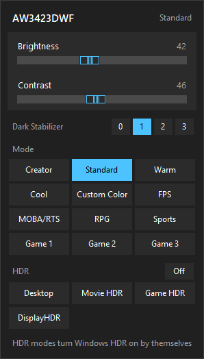

# aw3423dwf-tray

A tray app that replaces the quick menu of the old Dell Display Manager for the
Alienware AW3423DWF. It talks to the monitor directly over DDC/CI, so it works
alongside Dell Display and Peripheral Manager (DDPM) without depending on it.



- Left click on the tray icon opens a panel with brightness, contrast, Dark Stabilizer,
  preset modes and HDR.
- Right click opens a menu with the same modes, Dark Stabilizer levels and the autostart toggle.
- HDR modes turn Windows HDR on first; SDR modes turn it off.
- Every mode switch is confirmed by reading VCP 0xE2 back from the monitor; a mismatch
  is shown in the panel.

Mode codes are in [VCP_MAP.md](VCP_MAP.md). Custom Color HDR and the HDR Peak 1000
toggle are not reachable over DDC/CI and stay in the monitor's own menu. Creator always
means Creator with the DCI-P3 color space; Creator sRGB is left to the monitor menu.

The interface is in Russian.

## Compatibility and disclaimer

This is an unofficial project. It is not affiliated with, endorsed by or supported by
Dell Technologies; Dell and Alienware are trademarks of Dell Inc. or its subsidiaries.

The codes were found on one AW3423DWF with firmware M3B107 on Windows 11. Other
firmware versions or other Alienware and Dell models may use different codes. DDC/CI
does not work over Remote Desktop. Use it at your own risk: the app writes settings
to the monitor the same way its on-screen menu and DDPM do, and every change can be
undone from the monitor's menu.

For another monitor, `tools/probe_vcp.py watch` shows which codes change while you
switch modes from the monitor's menu; `modes.py` and `VCP_MAP.md` are the places to
record what you find.

## Run from source

Quit the installed copy first (tray menu → Выход): only one instance runs at a time.

```
uv sync
uv run python -m aw_tray
```

## Build and install

```
uv run python -c "from aw_tray.app import _icon_image; _icon_image().save('icon.ico', sizes=[(16,16),(24,24),(32,32),(48,48),(64,64)])"
uv run pyinstaller --noconfirm --clean --onedir --windowed --name AWMonitorTray --icon icon.ico --paths . aw_tray\__main__.py
```

Copy `dist\AWMonitorTray` to `%LOCALAPPDATA%\Programs\AWMonitorTray` and turn on
"Запускать при входе в Windows" in the tray menu.

## Tools

- `tools/probe_vcp.py snapshot|watch` reads VCP codes without writing anything; `watch`
  logs every change, which is how the mode codes were found.
- `tools/panel_shot.py out.png` opens the real panel and saves a screenshot of it
  (run with `PYTHONPATH` set to the project root).

## License

[MIT](LICENSE)
